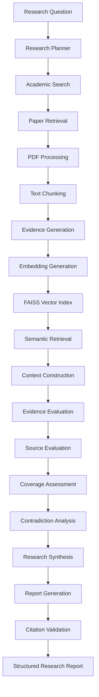

# ResearchPilot

### Evidence-Driven AI Research Assistant

ResearchPilot is an agentic AI research assistant that transforms natural-language research questions into structured, evidence-backed research reports.

It automates academic paper discovery, PDF acquisition, text extraction, evidence generation, semantic retrieval, evidence evaluation, research synthesis, and citation validation through an orchestrated research pipeline.

The objective is to make academic research more systematic, traceable, and efficient by connecting LLM engineering, agentic AI, Retrieval-Augmented Generation (RAG), and evidence evaluation in one application.

---

## Table of Contents

- [Overview](#overview)
- [Core Capabilities](#core-capabilities)
- [Research Workflow](#research-workflow)
- [System Architecture](#system-architecture)
- [Technology Stack](#technology-stack)
- [Project Structure](#project-structure)
- [Installation](#installation)
- [Configuration](#configuration)
- [Running the Application](#running-the-application)
- [API Documentation](#api-documentation)
- [Testing](#testing)
- [Current Project Status](#current-project-status)
- [Development Roadmap](#development-roadmap)
- [Engineering Principles](#engineering-principles)
- [Limitations](#limitations)
- [Security](#security)

---

## Overview

ResearchPilot addresses a common problem in academic research: gathering relevant papers, extracting useful information, evaluating evidence, and organizing findings into a coherent research report requires substantial manual effort.

ResearchPilot automates this workflow.

A user submits a research question. The system develops a research plan, discovers academic papers, retrieves relevant evidence, evaluates its quality, and generates a structured report with traceable citations.

### Key Objectives

1. **LLM Engineering:** Build reliable LLM integrations with structured outputs, error handling, and reusable components.
2. **Agentic AI:** Coordinate research planning, tool execution, and multi-step workflows.
3. **RAG Engineering:** Build an end-to-end retrieval pipeline using embeddings, vector indexing, and semantic search.
4. **Evidence Evaluation:** Assess evidence quality, source credibility, research coverage, and contradictions.
5. **Research Synthesis:** Generate structured findings and reports with validated source references.

---

## Core Capabilities

### 1. Research Planning

- Accepts natural-language research questions.
- Decomposes research questions into focused sub-questions.
- Generates structured research plans using Pydantic.
- Creates purpose-driven search queries.
- Classifies queries by source type.
- Prioritizes academic research sources.

### 2. Academic Paper Discovery

- Integrates with the OpenAlex academic research API.
- Searches for relevant academic publications.
- Retrieves paper metadata and abstracts.
- Deduplicates discovered papers.
- Coordinates academic retrieval through a retrieval pipeline.

### 3. PDF Acquisition and Processing

- Downloads academic PDF documents.
- Extracts text from PDF files.
- Preserves page-level information.
- Normalizes extracted text.
- Splits documents into manageable text chunks.
- Generates deterministic evidence identifiers.
- Maintains paper and document provenance.

### 4. Embedding and Vector Indexing

- Integrates OpenAI embedding models.
- Uses `text-embedding-3-small` by default.
- Supports configurable embedding dimensions.
- Stores embeddings using FAISS.
- Supports cosine similarity-based vector search.
- Implements batch evidence indexing.
- Handles duplicate evidence and existing records.
- Tracks indexed, skipped, and failed records.
- Supports vector persistence and loading.

### 5. Retrieval-Augmented Generation

- Retrieves relevant evidence through semantic search.
- Constructs source-attributed retrieval context.
- Preserves evidence identifiers and source metadata.
- Supports configurable retrieval parameters.
- Integrates retrieval with downstream research workflows.

### 6. Evidence Evaluation

- Evaluates retrieved evidence.
- Calculates evidence quality scores.
- Evaluates source credibility.
- Assesses research aspect coverage.
- Identifies potential contradictions.
- Maintains evidence provenance throughout the pipeline.

### 7. Research Synthesis and Report Generation

- Converts evaluated evidence into structured research findings.
- Maintains supporting evidence references.
- Generates research summaries.
- Organizes findings into report sections.
- Maps evidence identifiers to numeric source citations.
- Rejects findings with unresolved source references.
- Validates citations against the supplied research context.

### 8. Agentic Research Orchestration

- Coordinates the complete research workflow.
- Executes registered research tools.
- Maintains research execution state.
- Records individual workflow steps.
- Tracks completed and failed operations.
- Preserves structured research results.
- Handles workflow-level exceptions.

### 9. Research Workflow API

The FastAPI backend exposes the research workflow through REST endpoints.

Implemented endpoints:

| Method | Endpoint | Description |
|---|---|---|
| GET | `/health` | API health check |
| POST | `/api/v1/research` | Execute the complete research workflow |

Interactive API documentation is available through Swagger UI.

---

## Research Workflow

The current research execution pipeline follows these stages:

1. **Research Question:** Accept a research question from the user.
2. **Research Planning:** Decompose the question and generate academic search queries.
3. **Academic Retrieval:** Discover papers and acquire their full text.
4. **Evidence Processing:** Extract, normalize, chunk, and identify evidence.
5. **Evidence Indexing:** Generate embeddings and store evidence in FAISS.
6. **Semantic Retrieval:** Retrieve the most relevant evidence for the original question.
7. **Coverage Assessment:** Evaluate how well the retrieved evidence addresses the research aspects.
8. **Evidence Evaluation:** Evaluate evidence quality and source credibility.
9. **Contradiction Analysis:** Identify potential disagreements among retrieved evidence.
10. **Research Synthesis:** Generate structured findings with supporting evidence.
11. **Report Generation:** Construct the final research report.
12. **Citation Validation:** Verify that report citations reference available sources.
13. **Workflow Completion:** Preserve the structured result and execution history.

### Workflow Architecture



---

## System Architecture

ResearchPilot follows a modular, layered architecture.

| Layer | Responsibility |
|---|---|
| API | Exposes research workflow endpoints |
| Agent | Coordinates planning and execution |
| Planner | Generates structured research plans |
| Tools | Provides registered research capabilities |
| Retrieval | Discovers papers and acquires academic content |
| Full-text Processing | Extracts and generates evidence from PDFs |
| Embeddings | Converts text into vector representations |
| Vector Store | Stores and retrieves evidence embeddings |
| RAG Pipeline | Performs semantic retrieval and context construction |
| Evidence Evaluation | Evaluates evidence, sources, coverage, and contradictions |
| Generation | Synthesizes findings and generates research reports |

### Architecture Principles

- Modular component design.
- Separation of responsibilities.
- Typed data models and validation.
- Dependency injection for major pipeline components.
- Reusable services and interfaces.
- Traceable evidence provenance.
- Explicit error handling.
- Unit and integration testing.

---

## Technology Stack

| Category | Technologies |
|---|---|
| Programming Language | Python |
| LLM Integration | OpenAI API |
| LLM Model | Configurable, default `gpt-4o-mini` |
| Embeddings | OpenAI `text-embedding-3-small` |
| Academic Search | OpenAlex API |
| PDF Processing | PyMuPDF |
| Vector Database | FAISS |
| Numerical Computing | NumPy |
| Data Validation | Pydantic |
| Backend API | FastAPI |
| API Server | Uvicorn |
| HTTP Client | HTTPX |
| Configuration | Python-dotenv |
| Testing | pytest |
| Version Control | Git and GitHub |

### Planned Frontend

- Streamlit
- Interactive research dashboard
- API-connected workflow execution
- Structured research report visualization

---

## Project Structure

The project follows a Python `src` layout.

ResearchPilot/
│
├── src/
│   └── researchpilot/
│       │
│       ├── agent/
│       │   ├── __init__.py
│       │   ├── models.py
│       │   ├── orchestrator.py
│       │   └── research_agent.py
│       │
│       ├── api/
│       │   ├── __init__.py
│       │   ├── dependencies.py
│       │   ├── main.py
│       │   ├── routes/
│       │   │   ├── __init__.py
│       │   │   └── research.py
│       │   └── schemas/
│       │       ├── __init__.py
│       │       ├── request.py
│       │       └── response.py
│       │
│       ├── evidence/
│       │   ├── __init__.py
│       │   ├── aspect_coverage.py
│       │   ├── contradiction.py
│       │   ├── contradiction_evaluator.py
│       │   ├── contradiction_models.py
│       │   ├── coverage.py
│       │   ├── coverage_evaluator.py
│       │   ├── coverage_models.py
│       │   ├── evaluator.py
│       │   ├── models.py
│       │   ├── quality.py
│       │   ├── source_credibility.py
│       │   ├── source_evaluator.py
│       │   ├── source_models.py
│       │   ├── synthesis.py
│       │   ├── synthesis_models.py
│       │   └── synthesis_service.py
│       │
│       ├── generation/
│       │   ├── __init__.py
│       │   ├── citation_models.py
│       │   ├── citation_validator.py
│       │   ├── pipeline_models.py
│       │   ├── report_generator.py
│       │   ├── report_models.py
│       │   └── report_pipeline.py
│       │
│       ├── llm/
│       │   ├── client.py
│       │   ├── connection_check.py
│       │   ├── reliability.py
│       │   └── usage.py
│       │
│       ├── planner/
│       │   ├── plan_check.py
│       │   └── research_planner.py
│       │
│       ├── rag/
│       │   ├── __init__.py
│       │   │
│       │   ├── embeddings/
│       │   │   ├── __init__.py
│       │   │   ├── base.py
│       │   │   ├── models.py
│       │   │   └── openai_embeddings.py
│       │   │
│       │   ├── indexing/
│       │   │   ├── __init__.py
│       │   │   ├── base.py
│       │   │   ├── models.py
│       │   │   └── service.py
│       │   │
│       │   ├── pipeline/
│       │   │   ├── __init__.py
│       │   │   ├── citations.py
│       │   │   ├── context.py
│       │   │   ├── generation.py
│       │   │   ├── models.py
│       │   │   ├── prompt.py
│       │   │   └── service.py
│       │   │
│       │   ├── retrieval/
│       │   │   ├── __init__.py
│       │   │   ├── base.py
│       │   │   ├── models.py
│       │   │   ├── service.py
│       │   │   └── ranking/
│       │   │       ├── base.py
│       │   │       └── similarity_ranker.py
│       │   │
│       │   └── vectorstore/
│       │       ├── __init__.py
│       │       ├── base.py
│       │       ├── faiss_store.py
│       │       ├── filters.py
│       │       └── models.py
│       │
│       ├── retrieval/
│       │   ├── __init__.py
│       │   ├── models.py
│       │   ├── pipeline.py
│       │   ├── pipeline_models.py
│       │   │
│       │   ├── academic/
│       │   │   ├── __init__.py
│       │   │   ├── base.py
│       │   │   └── openalex.py
│       │   │
│       │   ├── fulltext/
│       │   │   ├── __init__.py
│       │   │   ├── chunker.py
│       │   │   ├── downloader.py
│       │   │   ├── evidence.py
│       │   │   ├── extractor.py
│       │   │   ├── models.py
│       │   │   ├── normalizer.py
│       │   │   └── service.py
│       │   │
│       │   └── services/
│       │       ├── __init__.py
│       │       └── academic_search.py
│       │
│       ├── schemas/
│       │   └── research_plan.py
│       │
│       ├── tools/
│       │   ├── __init__.py
│       │   ├── academic_search.py
│       │   ├── base.py
│       │   ├── rag_retrieval.py
│       │   └── registry.py
│       │
│       ├── config.py
│       └── __init__.py
│
├── tests/
│   │
│   ├── agent/
│   │   ├── test_agent_models.py
│   │   ├── test_full_research.py
│   │   ├── test_orchestrator.py
│   │   └── test_research_agent.py
│   │
│   ├── api/
│   │   └── test_research.py
│   │
│   ├── evidence/
│   │   ├── test_aspect_coverage.py
│   │   ├── test_citation_validator.py
│   │   ├── test_contradiction_evaluator.py
│   │   ├── test_contradiction.py
│   │   ├── test_coverage_evaluator.py
│   │   ├── test_coverage.py
│   │   ├── test_evaluator.py
│   │   ├── test_quality.py
│   │   ├── test_report_generator.py
│   │   ├── test_report_pipeline.py
│   │   ├── test_source_credibility.py
│   │   ├── test_source_evaluator.py
│   │   ├── test_synthesis_service.py
│   │   └── test_synthesis.py
│   │
│   ├── integration/
│   │
│   ├── rag/
│   │   ├── test_answer_generation_service.py
│   │   ├── test_citation_validator.py
│   │   ├── test_context_builder.py
│   │   ├── test_faiss_store.py
│   │   ├── test_indexing_models.py
│   │   ├── test_indexing_service.py
│   │   ├── test_metadata_filters.py
│   │   ├── test_openai_embeddings.py
│   │   ├── test_rag_pipeline_integration.py
│   │   ├── test_rag_pipeline_service.py
│   │   ├── test_research_prompt_builder.py
│   │   ├── test_retrieval_base.py
│   │   ├── test_retrieval_models.py
│   │   ├── test_retrieval_service.py
│   │   ├── test_similarity_ranker.py
│   │   └── test_vectorstore_models.py
│   │
│   ├── retrieval/
│   │   ├── test_academic_provider.py
│   │   ├── test_academic_search.py
│   │   ├── test_evidence_generator.py
│   │   ├── test_fulltext_models.py
│   │   ├── test_fulltext_service.py
│   │   ├── test_models.py
│   │   ├── test_openalex.py
│   │   ├── test_pdf_downloader.py
│   │   ├── test_pdf_extractor.py
│   │   ├── test_pipeline.py
│   │   ├── test_text_chunker.py
│   │   └── test_text_normalizer.py
│   │
│   ├── tools/
│   │   ├── test_academic_search.py
│   │   ├── test_base.py
│   │   ├── test_rag_retrieval.py
│   │   └── test_registry.py
│   │
│   └── unit/
│       ├── test_llm_client.py
│       ├── test_llm_reliability.py
│       ├── test_llm_usage.py
│       ├── test_research_plan_schema.py
│       └── test_research_planner.py
│
├── data/
│   └── papers/
│
├── .env
├── .env.example
├── .gitignore
├── pyproject.toml
└── README.md

*The structure above highlights the main application modules. Individual modules and test files are maintained within their respective packages.*

---

## Installation

### Prerequisites

- Python 3.10 or later
- Git
- OpenAI API key
- Internet connection for academic search, PDF acquisition, and API access

### 1. Clone the repository

```bash
git clone https://github.com/varunvsSrivastava/ResearchPilot.git
cd ResearchPilot
```

### 2. Create a virtual environment

Windows PowerShell:

```powershell
python -m venv .venv
```

Activate it:

```powershell
.venv\Scripts\Activate.ps1
```

Linux/macOS:

```bash
python -m venv .venv
source .venv/bin/activate
```

### 3. Install dependencies

Upgrade pip:

```bash
python -m pip install --upgrade pip
```

Install the project and its dependencies:

```bash
pip install -e .
```

### 4. Configure environment variables

Create a `.env` file in the project root.

Refer to the configuration section below.

---

## Configuration

ResearchPilot uses environment variables for API credentials and model configuration.

Create a `.env` file:

```env
# OpenAI API
OPENAI_API_KEY=your_openai_api_key
OPENAI_MODEL=gpt-4o-mini

# Embedding configuration
OPENAI_EMBEDDING_MODEL=text-embedding-3-small
OPENAI_EMBEDDING_DIMENSIONS=1536

# PDF processing
PDF_STORAGE_DIR=data/papers
PDF_DOWNLOAD_TIMEOUT=30
PDF_MAX_SIZE_BYTES=52428800
```

### Configuration Reference

| Variable | Default | Description |
|---|---|---|
| `OPENAI_API_KEY` | Required | OpenAI API authentication |
| `OPENAI_MODEL` | `gpt-4o-mini` | LLM model |
| `OPENAI_EMBEDDING_MODEL` | `text-embedding-3-small` | Embedding model |
| `OPENAI_EMBEDDING_DIMENSIONS` | `1536` | Embedding vector dimensions |
| `PDF_STORAGE_DIR` | `data/papers` | PDF storage location |
| `PDF_DOWNLOAD_TIMEOUT` | `30` | PDF download timeout in seconds |
| `PDF_MAX_SIZE_BYTES` | `52428800` | Maximum PDF size in bytes |

**Important:** Keep the `.env` file private. Never commit API keys or credentials.

---

## Running the Application

### 1. Start the FastAPI backend

From the project root:

```powershell
uvicorn researchpilot.api.main:app --reload
```

The API will be available at:

```text
http://127.0.0.1:8000
```

### 2. Check API health

Open:

```text
http://127.0.0.1:8000/health
```

Expected response:

```json
{
  "status": "healthy"
}
```

### 3. Open API documentation

Swagger UI:

```text
http://127.0.0.1:8000/docs
```

Alternative API documentation:

```text
http://127.0.0.1:8000/redoc
```

### 4. Execute a research request

Use the `POST /api/v1/research` endpoint.

Example request:

```json
{
  "research_question": "What are the recent applications of retrieval-augmented generation in healthcare?"
}
```

The backend executes the research workflow and returns a structured response containing the research result, execution details, and workflow status.

---

## API Documentation

### Health Check

**GET** `/health`

Checks whether the API service is operational.

### Execute Research

**POST** `/api/v1/research`

Accepts a research question and executes the full research workflow.

Example:

```json
{
  "research_question": "How can retrieval-augmented generation improve clinical decision support?"
}
```

The response includes:

- Research question.
- Research plan.
- Execution steps.
- Tool execution results.
- Workflow status.
- Structured research findings.
- Supporting citations.
- Citation validation.
- Error information when applicable.

### Workflow Status

The workflow tracks its execution state.

| Status | Meaning |
|---|---|
| `running` | Research execution is in progress |
| `completed` | Research workflow completed successfully |
| `failed` | An execution step failed |

An HTTP 200 response alone should not be interpreted as successful research completion. Check the workflow status and error fields in the response.

---

## Testing

ResearchPilot uses pytest for unit and integration testing.

The test suite covers:

- LLM client behavior.
- Research planning.
- Academic retrieval.
- PDF processing.
- Evidence generation.
- Embedding integration.
- Vector store operations.
- Evidence indexing.
- Semantic retrieval.
- RAG pipeline integration.
- Evidence evaluation.
- Research synthesis.
- Report generation.
- Citation validation.
- Agent orchestration.
- FastAPI endpoints.

### Run all tests

```powershell
pytest -v
```

### Run a specific test module

```powershell
pytest tests/evidence/test_report_pipeline.py -v
```

### Run API tests

```powershell
pytest tests/api/ -v
```

### Run evidence/report tests
pytest tests/evidence/ -v

### Current Validation

As of November 17, 2026:

- **392 tests passed**
- Live FastAPI research workflow executed successfully.
- Research workflow status: `completed`.
- Citation validation: `is_valid: true`.
- Nine cited sources validated successfully.
- No invalid sources.
- No missing citations.
- No workflow error.

These results represent the latest verified development checkpoint, not a guarantee that every future change will retain the same results.

---

## Current Project Status

### Completed

| Phase | Description | Status |
|---|---|---|
| Phase 1 | Project Foundation | Completed |
| Phase 2 | Core LLM Engineering | Completed |
| Phase 3 | Academic Search Integration | Completed |
| Phase 4 | PDF Processing and Evidence Generation | Completed |
| Phase 5 | RAG and Retrieval Engineering | Completed |
| Phase 6 | Evidence Evaluation and Research Report Generation | Completed |
| Phase 7 | Agentic Research Orchestration | Completed |
| Phase 8 | Research Workflow API | Completed |
| Phase 9 | API Integration and End-to-End Validation | Completed |

### In Progress

| Phase | Description | Status |
|---|---|---|
| Phase 10 | Research Workflow UI Integration | In Progress |

### Upcoming

- Streamlit research dashboard.
- Interactive workflow execution.
- Research progress visualization.
- Structured report rendering.
- Citation and source inspection.
- Report export functionality.
- API response optimization.
- Expanded evaluation and reliability testing.

---

## Development Roadmap

### Frontend Integration

The upcoming Streamlit interface will provide:

1. Research question submission.
2. Research execution controls.
3. Workflow status and progress visualization.
4. Research plan inspection.
5. Execution step monitoring.
6. Structured finding presentation.
7. Citation and source inspection.
8. Error reporting.
9. Research report export.

### Future Improvements

- Multi-source web search integration.
- Improved retrieval ranking.
- Retrieval evaluation metrics.
- Advanced research synthesis.
- Cross-paper comparison.
- Improved contradiction analysis.
- Report export to PDF and Markdown.
- API response optimization.
- Deployment and observability improvements.

---

## Engineering Principles

ResearchPilot is developed with an emphasis on software engineering quality.

### Modularity

Each major responsibility is implemented in a dedicated package or service.

### Type Safety

Pydantic models validate structured data across system boundaries.

### Testability

Services are designed to support isolated unit tests and integration tests.

### Traceability

Evidence identifiers and source metadata are preserved across retrieval, evaluation, and report generation.

### Reliability

External API interactions include error handling and controlled failure behavior.

### Citation Integrity

Report generation rejects unresolved evidence references rather than silently producing unsupported citations.

### Maintainability

The project uses a structured source layout, reusable interfaces, dependency injection, and Git-based version control.

---

## Limitations

ResearchPilot is an evolving research engineering project. Its outputs should be interpreted with the following limitations in mind:

- Academic search coverage depends on the external OpenAlex API.
- PDF availability and extraction quality depend on the source documents.
- Semantic retrieval quality depends on embedding quality and indexed evidence.
- Research findings are constrained by the retrieved evidence and context limits.
- LLM-generated synthesis can contain interpretation errors.
- Citation validation confirms source-reference traceability, not the scientific correctness of every generated claim.
- External API availability, rate limits, and model usage costs can affect execution.

ResearchPilot is designed to assist research workflows, not replace critical evaluation by researchers.

---

## Security

- Store API keys in environment variables.
- Keep `.env` out of version control.
- Do not commit private research documents.
- Avoid exposing credentials in logs or API responses.
- Validate inputs at application boundaries.
- Treat external academic content as untrusted input.

---

## Author

**Varun Srivastava**

Software Engineer | AI/ML Engineer

GitHub: [varunvsSrivastava](https://github.com/varunvsSrivastava)

Project Repository: [ResearchPilot](https://github.com/varunvsSrivastava/ResearchPilot)

---

## License

No license has been specified yet. All rights are reserved by default unless a license is added to this repository.
